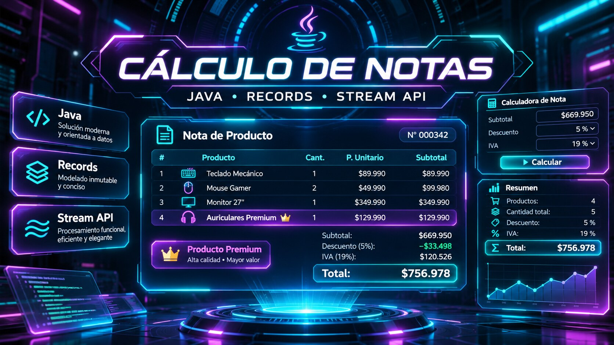
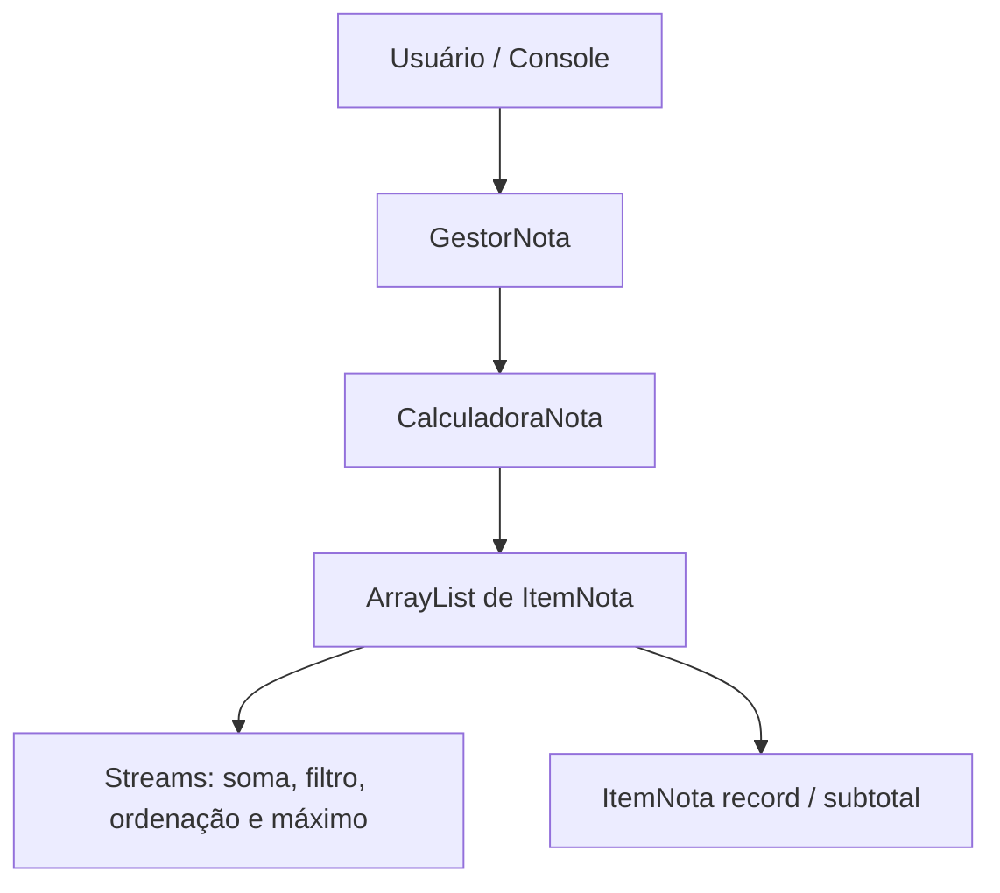

<div align="center">
  
</div>

<div align="center">

# C Á L C U L O　D E　N O T A S　//　J A V A

### `JAVA • RECORDS • COLLECTIONS • STREAM API`

**Sistema de terminal para cadastrar produtos, calcular subtotais e total da nota e consultar itens.**


`FATEC • ADS` · `JAVA CORE` · `PROJETO ACADÊMICO`

[Visão geral](#visao-geral) · [Funcionalidades](#funcionalidades) · [Arquitetura](#arquitetura) · [Execução](#execucao)

</div>

---

<a id="visao-geral"></a>

## `PROJECT // VISÃO GERAL`

O **CalculoDeNotas.Java** é um exercício Java de processamento de itens de uma nota de produtos, utilizando `record`, `ArrayList` e `Stream API`. Cada item tem nome, quantidade e preço unitário. O subtotal é `quantidade × preçoUnitario`, e a classe `CalculadoraNota` reúne os cálculos da coleção.

O menu em `GestorNota` recebe dados pelo terminal, valida campos básicos e chama as operações da calculadora. Os itens permanecem **somente na memória** durante a execução; não existe banco de dados nem API.

<a id="funcionalidades"></a>

## `SYSTEM // FUNCIONALIDADES`

| Opção | Operação |
| :---: | :--- |
| `1` | Adicionar item, com validação de nome, quantidade e preço |
| `2` | Calcular o valor total da nota |
| `3` | Listar nomes de produtos com preço unitário acima de R$ 100,00 |
| `4` | Encontrar o produto com maior preço unitário |
| `5` | Listar todos os itens, quantidades, preços e subtotais |
| `0` | Sair do programa |

**Regras técnicas:** `calularTotalGeral()` usa `mapToDouble().sum()`, `listarProdutosPremium()` combina `filter()`, `map()` e `sorted()`, e `encontrarMaisCaro()` usa `max(Comparator.comparingDouble(...))`. `getItens()` retorna uma visão não modificável da lista.

<a id="arquitetura"></a>

## `ARCHITECTURE // CAMADAS DO EXERCÍCIO`



## `STRUCTURE // ORGANIZAÇÃO`

```text
CalculoDeNotas.Java/
├── src/
│   ├── model/
│   │   └── ItemNota.java
│   ├── CalculadoraNota.java
│   └── GestorNota.java
└── README.md
```

| Arquivo | Responsabilidade |
| :--- | :--- |
| [`src/model/ItemNota.java`](src/model/ItemNota.java) | Record do produto e cálculo do subtotal |
| [`src/CalculadoraNota.java`](src/CalculadoraNota.java) | Coleção e regras de cálculo |
| [`src/GestorNota.java`](src/GestorNota.java) | Menu, leitura de dados e apresentação dos resultados |

<a id="execucao"></a>

## `BOOT SEQUENCE // EXECUTAR NO LINUX`

**Pré-requisito:** JDK 17 ou superior.

```bash
git clone https://github.com/gilbertocorrea-cmd/CalculoDeNotas.Java.git
cd CalculoDeNotas.Java
mkdir -p out
javac -d out src/model/ItemNota.java src/CalculadoraNota.java src/GestorNota.java
java -cp out GestorNota
```

Os valores são perdidos quando o processo é encerrado. Não foram adicionadas dependências externas.

## `LEARNING // CONCEITOS PRATICADOS`

`record` · `ArrayList` · `Collections.unmodifiableList` · `Optional` · `Stream` · `mapToDouble` · `sum` · `filter` · `map` · `sorted` · `Comparator` · `Scanner` · `switch` · `try/catch`.

---

<div align="center">

### `NOTE CALCULATOR // CODE • LEARN • BUILD`

**Gilberto Corrêa** · Análise e Desenvolvimento de Sistemas — FATEC

[GitHub](https://github.com/gilbertocorrea-cmd)

</div>
